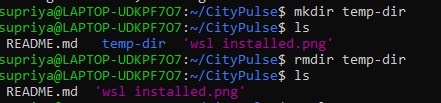
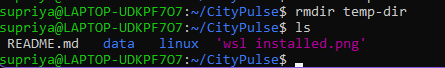
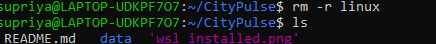
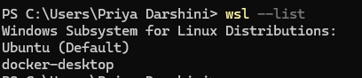

# Atria-CityPulse

This repository contains my Linux command-line homework and the screenshots recorded during the exercises. It demonstrates basic WSL setup, directory management, file management, disk usage, permissions, processes, and environment commands.

## Environment

- **Name:** Supriya
- **Operating System:** Windows with Ubuntu through WSL
- **Repository:** CityPulse
- **Purpose:** Linux command-line practice

## Homework Overview

| Homework | Topic | Screenshot |
| --- | --- | --- |
| Question 1 | Create and remove directories | `task1.png`, `task1.1.png` |
| Question 2 | Remove files and directories | `task 2.png`, `task2.1.png` |
| Question 3 | Rename files and check disk usage | `task 3.png` |
| Question 4 | Change file permissions | `task 4.png` |
| Question 5 | View running processes and system environment | `task 5.png`, `wsl-installed.png` |

---

# Question 1: How do you create and remove directories?

## Explanation

The `mkdir` command creates a directory. The `rmdir` command removes a directory only when that directory is empty. The directory must not contain files or subdirectories.

## Commands Used

```bash
mkdir temp-dir
ls
rmdir temp-dir
ls
```

## Step-by-Step Procedure

1. Open Ubuntu or Windows Subsystem for Linux.
2. Move to the project directory:

   ```bash
   cd /mnt/c/Users/Priya\ Darshini/Desktop/CityPulse_Supriya/CityPulse
   ```

3. Create a directory named `temp-dir`:

   ```bash
   mkdir temp-dir
   ```

4. Confirm that the directory was created:

   ```bash
   ls
   ```

5. Remove the empty directory:

   ```bash
   rmdir temp-dir
   ```

The directory named `temp-dir` should no longer appear after running `ls`.

## Screenshot Evidence

[](task1.png)

[](task1.1.png)

## Important Notes

- `mkdir directory-name` creates a directory.
- `rmdir directory-name` removes an empty directory.
- `rmdir` cannot remove a directory that contains files or subdirectories.

---

# Question 2: How do you remove files and directories recursively?

## Explanation

The `rm` command removes files. To remove a directory and all of its contents, use `rm -r`. To force removal and avoid prompts, use `rm -rf`, but this command must be used carefully because deleted data may not be recoverable.

## Commands Used

```bash
touch 123.png
rm 123.png

mkdir linux
rm -r linux
```

## Step-by-Step Procedure

### Remove a File

Create or identify the file first:

```bash
touch 123.png
ls
```

Remove the file:

```bash
rm 123.png
ls
```

The `123.png` file should disappear from the directory listing.

### Remove a Directory and Its Contents

Create a directory for practice:

```bash
mkdir linux
```

Remove it recursively:

```bash
rm -r linux
```

Confirm that it was removed:

```bash
ls
```

> **Warning:** `rm -r` permanently deletes the directory and everything inside it. Always confirm the path before running the command.

## Screenshot Evidence

[](task%202.png)

[](task2.1.png)

---

# Question 3: How do you rename files and check disk usage?

## Explanation

The `mv` command can rename a file or move it to another location. The `df` command displays disk and filesystem usage.

## Rename a File

Before renaming:

```bash
ls
```

Rename `2.png` to `22.png`:

```bash
mv 2.png 22.png
```

Verify the new name:

```bash
ls
```

The general syntax is:

```bash
mv old-name new-name
```

## Check Disk Usage

Display basic disk usage:

```bash
df
```

Display disk usage in a readable format:

```bash
df -h
```

The `-h` option displays sizes in human-readable units such as KB, MB, and GB.

Useful output columns include:

| Column | Meaning |
| --- | --- |
| Filesystem | Storage device or mounted filesystem |
| Size | Total size |
| Used | Space currently used |
| Avail | Available space |
| Use% | Percentage of used space |
| Mounted on | Filesystem mount location |

## Screenshot Evidence

[](task%203.png)

---

# Question 4: How do Linux file permissions work?

## Explanation

Linux assigns permissions to the owner, group, and other users.

| Permission | Symbol | Meaning |
| --- | --- | --- |
| Read | `r` | Read file contents or list directory contents |
| Write | `w` | Modify a file or change directory contents |
| Execute | `x` | Run a file or enter a directory |

The `chmod` command changes permissions. Permission modes contain three digits:

- Owner permissions
- Group permissions
- Other-user permissions

The numeric values are:

| Number | Permission |
| --- | --- |
| `4` | Read |
| `2` | Write |
| `1` | Execute |

## Commands Used

```bash
touch script.sh
ls -l script.sh
chmod +x script.sh
ls -l script.sh
chmod 644 script.sh
ls -l script.sh
```

## Step-by-Step Procedure

Create an empty shell script:

```bash
touch script.sh
```

View its initial permissions:

```bash
ls -l script.sh
```

Add execute permission:

```bash
chmod +x script.sh
```

Set read/write permission for the owner and read permission for others:

```bash
chmod 644 script.sh
```

## Common Permission Modes

| Mode | Meaning |
| --- | --- |
| `644` | Owner: read/write; group and others: read |
| `755` | Owner: read/write/execute; group and others: read/execute |
| `777` | Owner, group, and others: read/write/execute |

## Screenshot Evidence

[](task%204.png)

---

# Question 5: How do you view running processes and system information?

## Explanation

The `ps` command shows running processes. `ps aux` provides a system-wide process list with the process owner, process ID, CPU usage, memory usage, and command.

## Commands Used

```bash
ps aux
whoami
id
hostname
uname -a
who
```

## View Running Processes

```bash
ps aux
```

Important columns include:

| Column | Meaning |
| --- | --- |
| `USER` | Process owner |
| `PID` | Process ID |
| `%CPU` | CPU usage |
| `%MEM` | Memory usage |
| `STAT` | Current process state |
| `COMMAND` | Command that started the process |

## View User and System Information

```bash
whoami
id
hostname
uname -a
```

These commands display:

- The current username.
- User and group IDs.
- The computer or WSL hostname.
- Kernel and system details.

## Check Logged-In Users

```bash
who
w
```

These commands show active login sessions and terminal activity.

## Screenshot Evidence

[](task%205.png)

[](wsl-installed.png)

---
Q1 : To create a json object
{
    "city": "Bangalore",
    "state": "Karnataka",
    "country": "India",
    "temperature": 27,
    "weather": "Cloudy"
}

Q2:  To create a json object with array
{
    "city": "Bangalore",
    "areas": [
        "Hebbal",
        "RT Nagar",
        "Malleshwaram",
        "Indiranagar"
    ],
    "weather": "Cloudy"
}


# Screenshot Reference

| Screenshot | Description |
| --- | --- |
| `task1.png` | Creating and removing an empty directory |
| `task1.1.png` | Creating directories and organizing project files |
| `task 2.png` | Removing a file with `rm` |
| `task2.1.png` | Removing a directory recursively |
| `task 3.png` | Renaming a file and using `df -h` |
| `task 4.png` | Creating and changing permissions for `script.sh` |
| `task 5.png` | Listing running processes with `ps aux` |
| `wsl-installed.png` | Verifying WSL installation |

# Project Files

| Item | Purpose |
| --- | --- |
| `README.md` | Homework documentation |
| `script.sh` | Practice shell script file |
| `data/` | Text files used for file-management exercises |
| `linux/` | Directory used for directory-management exercises |
| `1.png` | Initial file exercise image |
| `2.png` | Image renamed during the file-management exercise |

# Learning Outcomes

After completing these exercises, I practiced:

- Opening and using WSL.
- Creating and removing directories.
- Removing files and directories safely.
- Renaming files with `mv`.
- Checking disk usage with `df -h`.
- Understanding and changing Linux permissions.
- Viewing running processes with `ps aux`.
- Identifying the current user and system environment.
- Documenting command-line work with screenshots.
